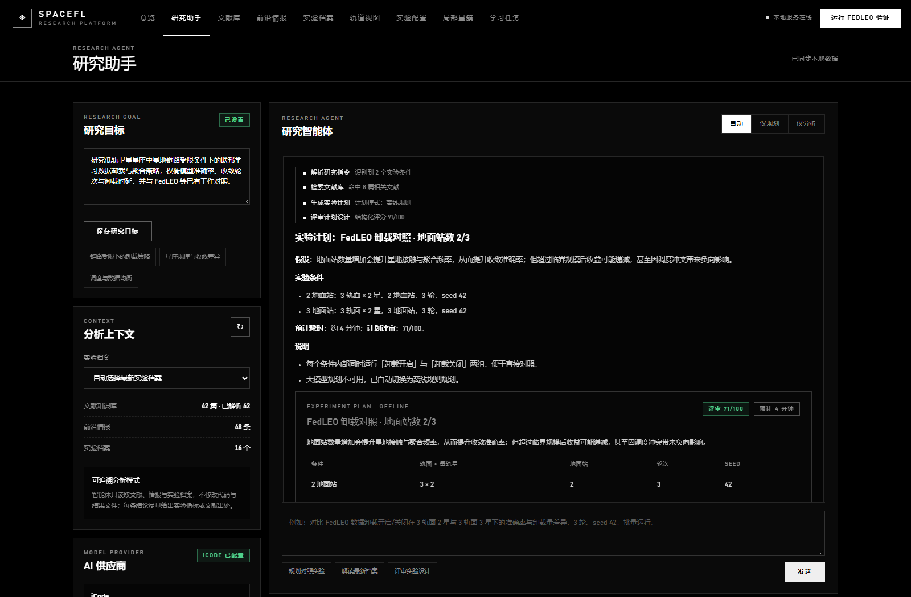
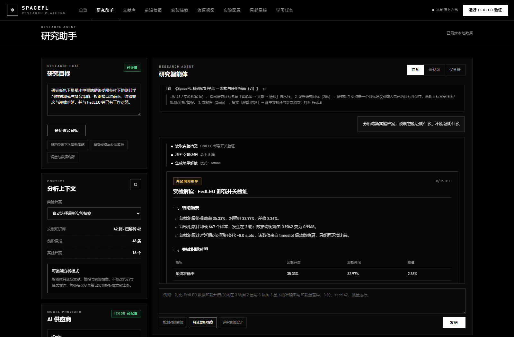
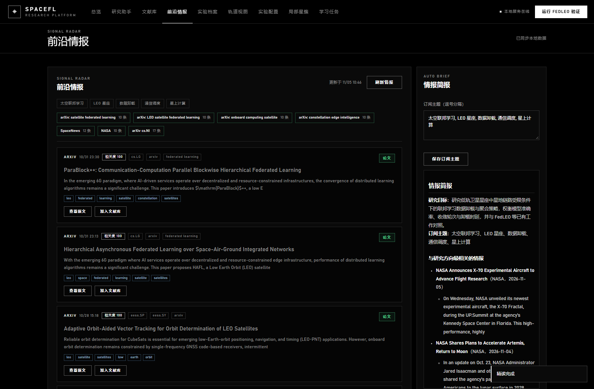

# SpaceFL 科研智能平台 — 架构与使用指南（v1）

> 面向全国人工智能创新应用大赛的科研软件形态：把「太空联邦学习实验台」升级为
> **研究目标驱动**的智能工作台 —— 内置期刊文献知识库、主动前沿情报、自然语言实验指令与
> 可追溯的实验计划/结果分析智能体。
>
> 接口契约见 [`RESEARCH_PLATFORM_V1.md`](RESEARCH_PLATFORM_V1.md)。

## 界面概览

| 视图 | 截图 |
|------|------|
| 总览（Hero + 研究目标 + 流水线） |  |
| 研究助手（实验计划卡片） |  |
| 研究助手（结果解读报告） |  |
| 期刊文献库（AI 精读 + 相关度） |  |
| 期刊文献库（知识库问答引用） |  |
| 前沿情报（相关度排序 + 简报） |  |

---

## 1. 平台定位

传统实验台解决「怎么跑实验」，科研智能平台进一步解决**「为什么跑、跑什么、结果能证明什么」**：

```
用户研究目标
   │
   ├─ 期刊文献知识库 ── PDF 全文解析 / 中文检索 / AI 精读 / 页码级引用
   ├─ 前沿情报雷达   ── arXiv + SpaceNews + NASA RSS 主动抓取与相关度排序
   │
   ▼
研究智能体：自然语言指令
   ├─ 计划生成  —— 假设、独立变量、条件、对照、指标、风险、预计耗时
   ├─ 计划评审  —— 变量是否真的变化、轮次/种子是否足够、对照是否公平（0–100 分）
   ├─ 批量执行  —— 后台子进程运行 FedLEO 卸载对照，实时进度与逐条件指标
   └─ 结果解读  —— 曲线统计 + 与文献对照 + 「尚不能支持的结论」+ 下一步建议
```

**科研规范性设计**：

| 设计 | 目的 |
|------|------|
| `mode: llm / offline` 字段 | 界面如实标注当前是大模型还是离线规则引擎产出，避免把规则输出误当模型能力 |
| 「尚不能支持的结论」章节 | 强制区分功能验证 / 趋势证据 / 论文级复现，禁止夸大 |
| 样本守恒、验收门槛（gates）检查 | 判断卸载是否真实发生、对照组是否同初始模型 |
| 文献 `[n]` 引用（含页码） | 结论可溯源，避免无出处的断言 |
| 实验条件上限（≤6 组、≤30 轮） | 防止一次点击跑出不可解释的超长任务 |

---

## 2. 代码结构

```
fl_space/research/
  config.py      研究目标 / 订阅主题持久化（.spacefl_research_config.json）
  bilingual.py   中英领域词典：中文查询扩展英文关键词，改善英文文献召回
  providers.py   大模型供应商抽象（chat / responses / anthropic 三协议 + 脱敏）
  literature.py  文献扫描、pypdf 抽取、分块、BM25 检索、RAG 上下文
  intel.py       arXiv / RSS 抓取、缓存、归档入库
  planner.py     自然语言 → 结构化实验计划（LLM + 离线规则双实现）
  analyzer.py    实验计划评审、结果分析、文献精读、情报简报
  service.py     编排层：文献/情报/供应商/规划/分析/后台任务
web/
  index.html         新版外壳（顶部导航 + Hero + 9 个视图）
  assets/app.js      既有实验视图逻辑
  assets/research.js 研究助手 / 文献库 / 前沿情报交互
  assets/app.css     太空官方风格主题（纯黑、1px 描边、DIN 风格大写标签）
  assets/research.css 新组件样式
  server.py          FastAPI：既有路由 + /api/research/*
  research_routes.py 研究平台路由注册
scripts/run_research_plan.py  后台批量实验执行器（子进程）
tests/test_research_*.py      离线测试（文献 21 + 情报 14 + 供应商/执行器 53 + 规划/分析/编排 61）
```

### 数据文件

| 文件 | 内容 | 是否入库 |
|------|------|----------|
| `.spacefl_research_config.json` | 研究目标、订阅主题 | 否（gitignore） |
| `.spacefl_literature_index.json` | 文献索引缓存（元数据 + chunk 数，不含全文） | 否 |
| `.spacefl_intel_cache.json` | 情报缓存（含抓取时间与来源状态） | 否 |
| `.spacefl_intel_ingested.json` | 已归档情报 id | 否 |
| `.spacefl_digests.json` | AI 精读缓存（按「文档修改时间 + 研究目标 + 版本」失效） | 否 |
| `文献/extracted/*.txt` | PDF 抽取文本缓存（`===== PAGE n =====` 分节） | 否 |
| `research_results/<job_id>/` | plan / progress / research_result / runner.log | 否 |

---

## 3. 功能详解

### 3.1 期刊文献知识库

- **接入方式**：默认目录 `文献/`（或 `.literature_config.json` 指定），支持拖拽导入 PDF / Markdown / TXT；
  「＋ 导入文献」写入目录后自动重建索引。
- **解析**：pypdf 逐页抽取；做连字还原（fi→fi）与行尾断词还原；抽取结果缓存为文本，二次启动增量复用；
  无法解析的 PDF 会记录 error 但不影响整体索引。
- **元数据**：标题 / 作者 / 年份 / 出处 / 摘要 / 关键词从首页文本启发式抽取（Abstract 到 Introduction 之间），
  Markdown 用一级标题与首段。
- **检索**：中文按二元组、英文按词元建 BM25 索引；标题命中加权；`bilingual.py` 把中文查询扩展出
  `federated learning / satellite / offloading …` 等领域词，解决「中文提问、英文论文」的召回问题。
- **AI 精读**：摘要、主要贡献、方法要点、关键发现、局限与未来工作、可引用原文、与研究目标相关度 0–100；
  离线模式用启发式句子抽取 + 关键词重合度，大模型模式生成结构化 JSON。
- **知识库问答**：BM25 召回片段 → 大模型归纳（无 Key 时输出检索式回答），每条结论带 `[n] 《标题》 p.页码`。

### 3.2 前沿情报雷达

- **来源**：4 组 arXiv 检索式（卫星联邦学习 / LEO FL / 星上计算 / 星座边缘智能）+ 太空日报 + SpaceNews + NASA + arXiv cs.NI。太空日报通过公开 RSS 获取标题、发布时间、摘要和原文链接，不复制新闻全文。
- **缓存**：默认 30 分钟 TTL，请求失败按来源降级并显示 `status`；「刷新情报」强制拉取。
- **排序**：抓取结果按「与研究目标 + 订阅主题的中英关键词重合度」计算 `relevance (0–100)`，
  再按相关度、发布时间排序，避免通用航天新闻淹没领域论文；界面显示相关度与命中关键词。
- **归档**：arXiv 条目下载 PDF、抽取正文并写入 `文献/<安全标题>.md`（含元数据与摘要），随后增量重建索引，
  已归档条目状态持久化。

### 3.3 研究智能体

| 意图 | 触发词示例 | 行为 |
|------|-----------|------|
| 情报简报 | 「最新前沿资讯」「arXiv 有什么新论文」 | 读取情报缓存 → 与目标对齐的简报 |
| 实验规划 | 「规划/对比/批量…」 | 检索文献 → 生成计划 → 结构化评审 → 返回计划卡片 |
| 批量执行 | 同上 + 「运行/跑/执行」 | 提交后台任务，页面实时显示进度与逐条件指标 |
| 结果解读 | 「分析/解读/能证明什么」 | 读取实验档案或批量结果 → 指标统计 + 文献对照 + 局限说明 |
| 文献问答 | 其它问题 | 知识库 RAG 问答并附引用 |

**自然语言解析能力**（离线规则模式）：中文数字与全角字符、`N 颗卫星 / N 个地面站 / N 个轨道面 /
每轨面 N 颗星 / N 轮 / seed N / 学习率 / batch / epoch / 样本上限`、`3/5/10` 列表网格、
`3 轨面 2 星与 3 轨面 3 星` 显式拓扑对照、多 seed 重复、快速模式；不支持的条件会写进 `notes` 说明而非静默忽略。

**计划结构（节选）**：

```json
{
  "title": "FedLEO 卸载对照 · 地面站数 2/3",
  "hypothesis": "地面站数量增加会提升星地接触与聚合频率……",
  "independent_variables": [{"name": "gs", "label": "地面站数", "values": [2, 3]}],
  "conditions": [{"id": "c1", "name": "2 地面站",
                  "params": {"planes": 3, "sats_per_plane": 2, "gs": 2, "rounds": 3, "seed": 42}}],
  "controls": ["开/关两组共享同一数据划分……"],
  "metrics": ["final_accuracy", "accuracy_delta", "total_offloaded", "total_delay_slots"],
  "expected_duration_sec": 238,
  "notes": ["每个条件内部同时运行卸载开启/关闭两组……"]
}
```

**后台执行**：`research_results/<job_id>/plan.json` → 子进程 `scripts/run_research_plan.py` →
每条件写 `progress.json`（原子替换）→ 全部完成写 `research_result.json`；服务端轮询进度并支持终止任务。
单条件失败不阻塞后续条件，全部失败才标记任务失败。

---

## 4. 离线 / 在线双模式

| 能力 | 大模型模式（已配置 Key 且连通） | 离线规则模式（默认兜底） |
|------|------------------------------|------------------------|
| 实验计划 | 模型输出 JSON 计划后按执行器约束校验（越界自动收缩/截断） | 中文关键词 + 单位解析模板 |
| 计划评审 | 模型给出定性意见 | 7 项结构化检查 + 0–100 分 |
| 结果解读 | 指标 + 文献片段交给模型写报告 | 曲线统计 + 证据链 + 局限清单 |
| 文献精读 | 结构化 JSON 精读 | 摘要/贡献句/局限句抽取 + 关键词相关度 |
| 知识库问答 | 跨文献归纳并引用 | 检索片段列表 + 引用 |
| 情报简报 | 按相关度写要点与研究机会 | 规则模板 + 相关条目 |

> 演示提示：模型不可用时界面会显示「离线规则引擎」，所有按钮与流程仍然完整可用；
> 配置入口在「研究助手 → AI 供应商」，支持 OpenAI 兼容协议、Responses 协议、Anthropic Messages 协议，
> 以及从 CC Switch 导入；Key 仅保存在本地 `.spacefl_ai_config.json`，接口返回前脱敏（`sk-***abcd`）。

---

## 5. 比赛演示脚本（约 8 分钟）

1. **总览页（40s）**：说明 Hero 与四项指标（期刊文献 41 / 全文已解析 41 / 前沿情报 48 / 实验档案 16），
   指出研究目标条与「智能体 → 文献 → 情报」流水线。
2. **设置研究目标（20s）**：研究助手页点击一个目标建议或输入自己的目标并保存，说明目标贯穿检索/规划/分析/情报。
3. **文献库（2min）**：搜索「卸载 时延」→ 命中文翻译与英文原文；打开 FedLEO 文献 → AI 精读 →
   展示贡献、局限、与研究目标相关度 30/100；右侧知识库提问「FedLEO 的卸载增益在哪些场景下最大？」→
   10 条带页码引用。
4. **前沿情报（1min）**：刷新情报 → 7 个来源状态；第一屏是按相关度 100 排在最前的 arXiv 空间联邦学习论文；
   「加入文献库」归档；「生成简报」展示与本项目目标的联系。
5. **实验智能体（2.5min）**：输入自然语言批量指令 → 展示工具调用步骤、计划卡片（条件表、对照、预计耗时）、
   评审 71/100 与改进建议；说明可「运行计划」后台批量执行（演示预跑的 `research_results/` 任务）。
6. **结果解读（1.5min）**：打开既有实验档案解读 → 摘要、指标对照表、证据链、文献对照、
   「尚不能支持的结论」（轮次少 / 单 seed / 时延不可外推）、下一步建议。
7. **收尾（30s）**：强调离线兜底、科研规范性（引用与局限性）与可扩展性（新增算法/数据只需扩展执行器与规划模板）。

---

## 6. 常见问题

| 问题 | 处理 |
|------|------|
| 首次打开文献库为空 | 首次启动需后台解析 PDF（约 30s），可点「↻ 重建索引」并稍候；状态在统计行提示 |
| PDF 无法解析 | 需要 `pip install pypdf`（`pip install -e ".[web]"`）；无 pypdf 时只索引文件名与元数据 |
| 情报刷新失败 | 检查外网/代理；单来源失败只会显示该来源 error，不影响其它来源 |
| AI 请求 502 / 超时 | 中转服务不可用时自动降级为离线规则；界面徽章会显示「离线规则引擎」 |
| 批量实验太慢 | 每条件固定成本约 60–90s（数据准备 + 训练）；减少条件数、轮次或样本上限；预计耗时在计划卡片显示 |
| 任务卡住 | 任务卡片可「终止任务」；日志在 `research_results/<job_id>/runner.log` |

---

## 7. 测试与验证

```bash
# 科研平台离线测试（133 项）
python -m pytest tests/test_research_*.py -q

# 既有平台回归
python -m pytest tests/test_web_experiment_orbit.py tests/test_web_learning_task.py \
  tests/test_web_session_profiles.py -q

# 真实文献目录自检（首次约 30s）
python -c "
from pathlib import Path
from fl_space.research.literature import LiteratureIndex
idx = LiteratureIndex([('文献', Path('文献'))], Path('tmp/idx.json'), Path('tmp/ext'))
print(idx.rebuild()); print(idx.stats()); print(idx.search('卸载 时延', 3)[0]['title'])
"
```

浏览器端验证：`node tmp/e2e/run.js`（puppeteer-core + 本地 Edge，18 项 UI 断言：Hero 数据、
计划卡片、分析报告、文献精读、知识库问答、情报排序与简报）。

---

## 8. 后续路线

- 支持 FedProx / FedBuff 的批量执行后端（执行器已按 `backend` 字段预留扩展位）；
- 文献增量向量化检索（当前 BM25 + 双语扩展已满足中小型文献库）；
- 多 seed 结果的自动统计显著性检验（均值 ± 标准差、配对检验）；
- 实验计划与结果的版本化对比（同一计划多次运行的趋势面板）；
- 情报简报的定时生成与订阅推送。
