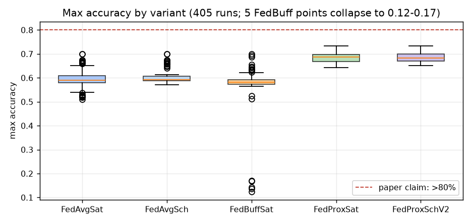
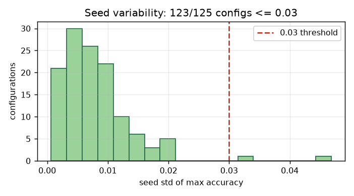
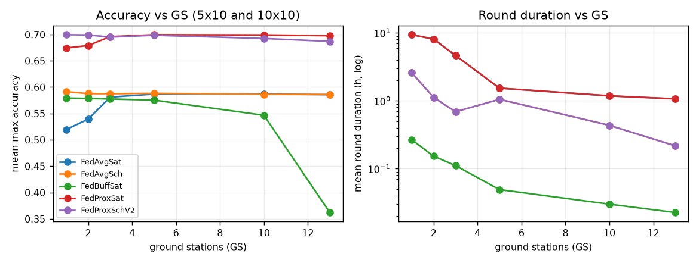
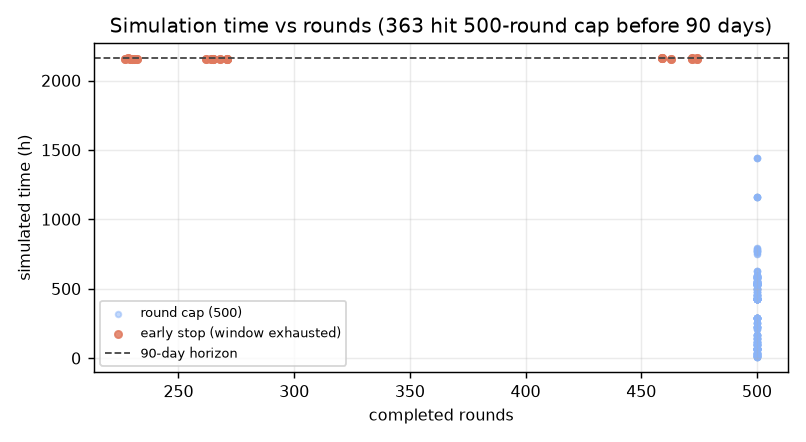
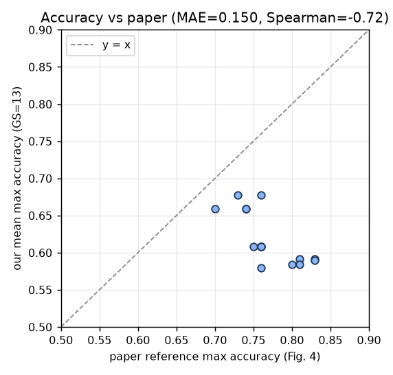

# SpaceFL 平台仿真可靠性分析（基于 2511.14889 横向对标实验数据）

> 数据来源：`比赛.7z` 中的 `比赛/experiment_outputs`（2026-11-06 完成），
> 固定源码提交 `45e169f9359afb4cdf750944dc9d793062615546`（`feature/starlink-sim-prep` 分支）。
> 本文由实验数据独立重算，不直接引用既有结论；与 `experiment_outputs/reports/reliability_report.md`
> 的口径保持一致：本批是**项目现有近似实现**的近似实验，不是论文严格复现。

---

## 0. 结论摘要

**一句话结论：平台"能稳定跑、能复现、能给出方向性趋势"，但"不能用于论文级数值复现，也不能宣称 9× 加速或 >80% 准确率"。**

| 可靠性维度 | 评级 | 关键证据 |
|---|---|---|
| 执行/工程可靠性 | **高** | 495 个任务：405 完成、90 个明确标记未支持、**0 失败**；194,992 轮；99.09 机时 |
| 工件/日志一致性 | **高** | 1,338,038 条同步事件顺序/时隙检查通过；405 个模型均 47,494 参数且有限；215 张图、93 份 CSV 校验通过 |
| 可复现性 | **中高** | 代表性配置独立复跑：history 2,097 个数值、raw_history 17,646、events 21,408、模型 47,494 个参数**全部零差异**；仅单配置/单环境 |
| 时间模型保真度 | **中低** | 195,397 条轮次时长**全部为整数分钟**（60s 槽向上取整）；125 个配置中 83 个种子间时长方差为 0 |
| 数值精度 | **低** | 最高准确率 **0.7333**，**0/405 达到 80%**；FedAvgSat 对论文 GS=13 准确率 MAE=0.150、Spearman=**-0.722** |
| 趋势/机制一致性 | **中** | GS↑→轮次时长↓（Spearman=-1，强）；GS↑→准确率仅 FedAvg/ FedProx 弱正；星座结构趋势不成立 |
| 论文数值对标 | **低** | 准确率不达建议阈值；轮次时长量级接近（平均相对误差 14.8%）但排序弱（Spearman=0.448） |
| 覆盖完整性 | **中低** | T2 两个 IntraCC 方法 90 次全部未支持；30 个配置只有 2 seeds；仅 FedAvgSat 有论文逐格参考值 |

**可安全使用的结论**：流程可复现、参数可追溯、GS 对轮次时长的影响方向明确、调度变体方向性提速、
FedBuff 空闲最低（定性）、绝大多数配置种子稳定（123/125 ≤0.03）。
**不可使用的结论**：论文级准确率、9× 加速、GS 越多准确率越高、sats/cluster 优于 clusters、
毫秒级时间精度、T2/IntraCC 结论。

---

## 1. 数据与口径

### 1.1 数据规模

| 项目 | 数值 |
|---|---:|
| 计划独立运行（合并重复后） | 495 |
| 完成近似实验 | **405** |
| 未支持（T2 IntraCC：FedAvgIntraSL 45 + FedProxIntraSL 45） | **90** |
| 失败 | **0** |
| 配置数（config×seed 聚合后） | 125 |
| 累计训练轮数 | **194,992** |
| 实际机时 | 99.09 h |
| 到达 500 轮上限 | 363 |
| 提前结束（窗口耗尽） | 42 |
| 论文参考数值配对格（仅 FedAvgSat） | 570 行（含两种指标/多个 GS） |

### 1.2 统计口径

- 每完成运行取 `summary.json` 的 `max_accuracy`、`round_duration_h`、`idle_time_h`、`completed_rounds` 等；
- 配置级统计来自 `summaries/summary_mean_std.csv`（每 seed 先算指标，再跨 seed 取均值与样本标准差 ddof=1）；
- 趋势检查来自 `reports/trend_checks.md` 与论文参考表 `paper_comparison/paper_vs_ours.csv`；
- 本轮独立重算覆盖：405 份 `summary.json`、405 份 `config.json`、195,397 条逐轮时长，
  以及 `output_validation.json`、`scheduler_validation.json`、`reproducibility_check.json` 等验证记录。

### 1.3 实验已声明的近似边界（影响可靠性解读）

1. 轨道：圆轨道 500 km、倾角 90°、二体 Kepler，地面站 5° 最小仰角、60s 采样，**非 STK/SGP4**；
2. 模型：MLP 784→56→62，47,494 参数（论文只公开约 47k；与建议 784→60→10 冲突）；
3. 时间：`PhysicsTimeModel` 把每个非零耗时向上取整到 60s 槽；
4. 选择器：FedAvgSat/FedProxSat 用随机选择，非论文"最早接触"；Sch 变体为近似实现；
5. 数据：FEMNIST 固定 100 writer 子集（每星 203–300 样本），固定划分、固定 seed42；
6. FedBuff：固定 1 epoch、近似版本与缓冲聚合，未完整实现论文异步机制；
7. 评估：每轮聚合后集中测试集评估，不是接触约束下的分布式评估。

---

## 2. 执行与工件可靠性：高

### 2.1 完成度

- 405/405 完成运行全部有 `history.csv`、`summary.json`、`config.json`、`events.json`、`model.pt`、日志；
- 90 个 T2 任务没有生成训练观测，状态明确为 `blocked_unsupported`，原因均为
  "FLIntraCC is not integrated in this project revision"，**没有把未支持任务伪装成失败或完成**；
- 405 个模型均为 4 个张量、47,494 个参数、全部有限；
- 所有完成运行都有 baseline 行（第 0 行），baseline 不进入训练统计。

### 2.2 结构与数值校验

| 校验 | 结果 |
|---|---|
| 同步事件整数时隙检查 | 1,338,038 条通过 |
| 同步事件操作顺序（download→train→upload→aggregate） | 1,338,038 条通过 |
| download/training 至少一个正时隙 | 各 1,338,038 条通过 |
| 模型张量形状/参数量/有限值 | 405/405 |
| 输入文件哈希不变 | 4/4 |
| 计划与 manifest 唯一性、495 任务精确展开 | 通过 |
| 配置快照、参数身份、seed/client 数一致性 | 495/495 |
| 媒体文件（热图 90 + 曲线 125 = 215 PNG） | 通过 |
| 分析 CSV 规范化 | 93/93，字段与记录数不变 |

### 2.3 调度/窗口适配器校验

- 调度适配器与**未修改的项目原调度器**对照：19 个矩阵、15,660 次 contact 查询、29,274 次 transfer 查询、
  28,512 次窗口转换查询、162 次窗口比较，全部通过；
- 15 个窗口几何，每个 129,600 个 60s 槽（90 天）；代表性几何的标量检查（如 10×10：记录 110 项、独立 263 项）通过。

> 结论：**工程执行和"项目内部语义"的一致性可信**；这不等于对 STK/真实轨道的物理验证。

### 2.4 可复现性

独立复跑 `FedAvgSat_C5_S10_GS1_seed42`（232 轮，同 CPU/依赖/单线程）：

| 对象 | 一致 | 比较数值数 | 最大绝对差 |
|---|---:|---:|---:|
| history.csv | 是 | 2,097 | 0 |
| raw_history.json | 是 | 17,646 | 0 |
| events.json | 是 | 21,408 | 0 |
| config.json | 是 | 40 | 0 |
| summary（排除 wall_seconds） | 是 | 14 | 0 |
| 模型 4 个张量 | 是 | 47,494 | 0 |

**边界**：只有 1 个代表性配置、同一环境、单次复跑；不能证明全网格、跨硬件或跨依赖版本的可复现性。
另外 seed 只改变初始化/选择器/洗牌，writer 队列与 train/test 划分固定，因此
**seed 标准差衡量的是"固定数据划分下的运行波动"，不是数据重采样方差**。

---

## 3. 数值可靠性：低（这是最大短板）

### 3.1 准确率总体

| 指标 | 数值 |
|---|---:|
| 405 次运行准确率均值 / 中位数 | 0.6244 / 0.6112 |
| 最小值 / 最大值 | **0.1250 / 0.7333** |
| ≥80%（论文宣称的 >80%） | **0 / 405** |
| ≥70% | 38 / 405 |
| <30% | 5 / 405（全部为 FedBuff 异常配置） |
| 达到 80% 的运行轮次（rounds_to_80） | **0/405 非空** |

论文 FedAvgSat 在 GS=13 的 15 个参考格为 0.70–0.83；本批对应值为 0.579–0.678，
**系统性偏低**，且没有一次达到 80%。

### 3.2 各方法对比

| 方法 | 完成运行 | 准确率均值 | 最低 | 最高 | 平均轮次 | 平均机时/次 |
|---|---:|---:|---:|---:|---:|---:|
| FedAvgSat | 84 | 0.5950 | 0.5108 | 0.7000 | 455.3 | 70.8 s |
| FedAvgSch | 84 | 0.6051 | 0.5714 | 0.7000 | 500.0 | 76.7 s |
| FedBuffSat | 84 | 0.5644 | **0.1250** | 0.7000 | 500.0 | 119.0 s |
| FedProxSat | 84 | **0.6838** | 0.6426 | **0.7333** | 455.3 | **2168.3 s** |
| FedProxSchV2 | 69 | 0.6844 | 0.6508 | 0.7333 | 500.0 | 2205.6 s |

- FedProx 类显著高于 FedAvg 类（+0.09 左右），调度变体相对基线没有准确率损失；
- FedBuff 均值被 5 个异常点拉低；剔除后均值为 **0.5907**，与 FedAvg 相当；
- FedProx 每次运行机时约为 FedAvg 的 **30 倍**（接触自适应整数 epoch 导致），是规模化的实际瓶颈。

### 3.3 关键异常：FedBuff 在 100 客户端 + GS=13 时 5 个种子全部崩溃

| 配置 | seeds | 最大准确率范围 | 轮数 | 仿真时长 |
|---|---|---:|---:|---:|
| FedBuffSat C10 S10 GS13 | 42,43,44,45,46 | **0.1250–0.1715** | 均 500 | 均 7.58 h |

- 5 个种子的精度都在 0.05–0.07（62 类随机基线约 0.016），属于**随机模型水平**；
- 逐轮 `train_loss` 除 baseline 外基本为 0，500 次 `server_aggregate` 均正常发生；
- 健康对照 `FedBuffSat C5 S10 GS13`（50 客户端）准确率 0.5736，说明不是 FedBuff 本身不可用，
  而是 **100 客户端 + 高 GS 的特定路径**出了问题；
- 该异常是**系统性**的（与 seed 无关），疑似与异步缓冲/陈旧更新在更短轮次下的聚合路径有关，
  需要回到项目代码定位，不能当作随机波动忽略。

> 影响：在"配置×seed"统计中，这 5 次运行会把 FedBuff 均值从 0.591 拉到 0.564；
> 在 GS 趋势上制造出"GS=13 准确率断崖"；在论文对标中污染相关格。

### 3.4 种子稳定性

- 123/125 个配置的准确率 seed 标准差 ≤0.03（98.4%），最大 0.0468（FedBuff 2×1 GS13）；
- 超过 0.03 的仅 2 个配置，均为 FedBuff 小星座（2×1、1×2，3 seeds）；
- 说明在"固定数据划分"下，运行随机性总体可控。

### 3.5 时间模型的"确定性"与量化

- 195,397 条轮次时长**全部是整数分钟**（60s 槽），共仅 622 个不同取值；
- 125 个配置中 **83 个** 的种子间时长标准差为 0（CV=0），85 个 CV<1e-6；
- 只有 42 个配置出现种子间时长差异。

这不是 bug，而是 60s 槽向上取整的**保真度限制**：
名义 2.45 ms/epoch、2.62 ms/传输都被抬到 60s，
所以"轮次时长的分钟/小时级趋势"可看，但**毫秒级硬件假设和精确 9× 加速不可由本数据验证**。

---

## 4. 趋势与机制可靠性：中

### 4.1 GS → 轮次时长：强且方向正确（C1 支持）

在 5×10 与 10×10 两个大星座上：

| 方法 | GS=1 时长(h) | GS=13 时长(h) | Spearman | GS 1→13 时长下降 |
|---|---:|---:|---:|---:|
| FedAvgSat (10×10) | 9.49 | 1.07 | **-1.0** | 88.7% |
| FedProxSat (10×10) | 9.49 | 1.07 | **-1.0** | 88.7% |
| FedAvgSch (10×10) | 2.89 | 0.237 | -0.83 | 91.8% |
| FedProxSchV2 (10×10) | 2.89 | 0.237 | -0.83 | 91.8% |
| FedBuffSat (10×10) | 0.198 | 0.0152 | **-1.0** | 92.3% |

更多地面站显著缩短轮次等待，这与论文"GS 数量是主导因素"的**方向**一致。
但注意：FedAvgSch/FedProxSchV2 在 GS=3→5 出现非单调（0.88→1.25h），说明调度近似在中等 GS 下不稳定。

### 4.2 GS → 准确率：只有部分方法弱正（C5 大部分不支持）

| 方法 | GS=1→13 准确率变化 | Spearman 范围 | 判断 |
|---|---|---:|---|
| FedAvgSat | +0.068（5×10）；+0.064（10×10） | 0.81 / 0.94 | 弱正，GS5 后基本平台 |
| FedProxSat | +0.018 / +0.029 | 0.83 / 0.83 | 弱正，GS5 后平台 |
| FedAvgSch | +0.001 / -0.012 | 0.43 / -0.83 | 基本不变 |
| FedProxSchV2 | -0.006 / -0.020 | -0.09 / -0.71 | 不变或略降 |
| FedBuffSat | -0.004 / **-0.430** | -0.54 / -0.94 | GS13 崩溃主导 |

按资料参考区间检查，趋势报告列出的 25 个代表性配置中只有 **8 个**落在区间内（且多为 GS=1 的低准确率区间），
大多数 GS=13 配置低于 0.70–0.90 区间。
**"GS 越多准确率越高"不能作为本批数据的结论**，只能表述为"对 FedAvg/FedProx 有弱正向、约 5 个 GS 后趋于饱和"。

### 4.3 星座结构：sats/cluster vs clusters（C2 不支持）

固定总星数（10/20/50）比较不同 `clusters × sats_per_cluster`：

- FedAvgSat 在 10 星总配置下（1×10、2×5、5×2、10×1）准确率几乎完全相同（0.6085）；
- FedBuff 在 10 星总配置下准确率仅 0.589–0.600，变化 <0.01；
- 空闲时间随簇数增加而增加（Spearman +0.8 在部分面板），即"更多簇"未必更优；
- 论文"每簇星数比簇数更重要"的方向**在本批数据中没有得到支持**，只能说明结构主要影响时序/空闲，不影响准确率量级。

### 4.4 调度加速（C3：方向支持，幅度约为论文一半）

- `FedAvgSat → FedAvgSch`：534.35h → 118.67h，**4.503×**；
- `FedProxSat → FedProxSchV2`：534.35h → 118.67h，**4.503×**；
- 论文宣称约 **9×**。方向一致，但幅度约为一半；且基线选择器（随机 vs 最早接触）不同，
  **不能把 4.503× 当作论文 9× 的验证或反驳**。

### 4.5 空闲时间（C4：定性支持，绝对不可比）

| 方法 | 平均累计 idle (h) | 平均每轮 idle (h) |
|---|---:|---:|
| FedAvgSat | 920.44 | 2.6029 |
| FedAvgSch | 398.97 | 0.7979 |
| FedBuffSat | **47.39** | **0.0948** |
| FedProxSat | 920.44 | 2.6029 |
| FedProxSchV2 | 374.46 | 0.7489 |

FedBuff 明显最低（每轮 idle 约为 FedAvg 的 1/27），**方向与论文一致**；
但累计 idle 受完成轮数和仿真时长影响（FedBuff 很多配置只跑了 7.6–15h），
论文 idle 的聚合口径未确认，因此**不能做绝对数值比较**。

### 4.6 提前结束与偏差（42 次）

- 42 次提前结束全部是 FedAvgSat/FedProxSat，GS∈{1,2,3}，簇数 5（30）或 10（12）；
- 全部在约 **2156h ≈ 90 天窗口末尾**结束，说明是"窗口耗尽/无可行轮次"的合法提前终止；
- 代价：FedAvgSat 提前结束组准确率均值 0.549，500 轮组 0.610，**低 GS 基线被系统性低估**；
- 363 次达到 500 轮上限的运行，仿真时长中位数仅 426h（约 17.8 天），
  说明"3 个月"场景只被 42 个低 GS 运行真正触及，**大部分运行验证的是 500 轮上限，而不是 90 天极限**。

---

## 5. 论文数值对标：低

本批只有 **FedAvgSat** 有论文 Fig.4 的逐格参考值（15 个 GS=13 的星座格，GS=1/2/3/5/10 各 2 格），
其余方法没有参考数值，无法做跨方法数值对标。

| 指标（GS=13） | 配对数 | MAE | 平均绝对相对误差 | 最大相对误差 | Spearman | 建议阈值 | 判定 |
|---|---:|---:|---:|---:|---:|---|---|
| max_accuracy | 15 | 0.1501 | 19.2% | 28.9% | **-0.722** | MAE≤0.10 且 Spearman≥0.6 | **不通过** |
| round_duration_h | 15 | 0.1513 h | 14.8% | 32.6% | **0.448** | 平均≤30%、单格≤50% | 量级通过，排序不通过 |

- **准确率**：数值系统性偏低（如论文 5×5 0.81 vs 本批 0.591；论文 5×10 0.83 vs 0.592），
  且 15 格排序与论文**负相关**——不能用于论文数值复现；
- **轮次时长**：量级接近（多数格相对误差 <20%），但排序相关性只有 0.448（<0.6），
  只能说明"时间量级大致可信"，不能说明"逐格排序可信"；
- **idle**：论文聚合口径未知，不做数值误差比较（`definition_check_required`）。

---

## 6. 论文 C1–C8 检查状态（基于本批数据）

| 检查 | 状态 | 依据 |
|---|---|---|
| C1 GS↑→轮次时长↓ | **支持（方向）** | 10 个面板中 6 个 Spearman=-1，4 个 -0.83～-0.94 |
| C2 星座结构 | **不支持/不明确** | 固定总星数下准确率几乎不变；空闲随簇数增加 |
| C3 调度加速 | **方向支持，幅度不足** | 4.503× vs 论文约 9×；选择器协议不同 |
| C4 空闲收益 | **定性支持** | FedBuff 每轮 idle 最低；绝对口径不可比 |
| C5 准确率区间 | **大部分不支持** | 0/405 达 80%；趋势报告列出的 25 个代表格仅 8 个在参考区间 |
| C6 最小 epoch 修正 | **无法验证** | 矩阵缺 FedProxSch 对照，只有 SchV2 近似 |
| C7 种子稳定性 | **基本支持** | 123/125 配置 std≤0.03；2 个 FedBuff 小星座 >0.03 |
| C8 同种子复跑 | **单点通过** | 1 个配置/单环境零差异；不能代表全网格 |

---

## 7. 平台可靠性的边界与风险清单

### 7.1 高风险（会直接影响结论）

1. **FedBuff 100 客户端 + GS=13 系统性崩溃**：5/5 seeds 随机水平，需定位聚合/陈旧更新路径；
2. **准确率整体偏低且排序反转**：不能用本批结果宣称"复现论文"或"达到 80%"；
3. **60s 槽时间量化**：毫秒级物理与精确加速倍数不可验证；
4. **低 GS 提前终止偏差**：GS≤3 的 FedAvg/FedProx 只跑 227–271 轮，低估基线准确率。

### 7.2 中风险（会影响覆盖与外部效度）

5. **T2/IntraCC 完全缺失**（90 次 blocked），无法覆盖星间协作结论；
6. **30 个配置只有 2 seeds**（T1b 缺 42/43/44），不能宣称"5 seeds 覆盖"；
7. **只有 FedAvgSat 有论文参考值**，FedProx/FedBuff/Sch 的方法级结论无法数值对标；
8. **数据固定 writer 子集/固定划分**：seed 方差 ≠ writer 重采样方差，缺乏数据敏感性；
9. **无仰角/步长/轨道库敏感性分析**：窗口结论不能外推到 STK 或真实星历；
10. **FedProx 运行时间 ~30× FedAvg**：全网格/多 seed 规模化的瓶颈。

### 7.3 低风险（工程层面已较好）

- 405/405 完成、0 失败、工件齐全、来源提交固定、CSV 规范化后哈希一致；
- 调度适配器与原调度器语义一致（15,660 次接触查询等）；
- 代表性配置同种子完全可复现（含模型 47,494 参数零差异）。

---

## 8. 建议的优先级

### P0（提交前/论文前必须处理）

1. **修复 FedBuff 异常**：在 100 客户端 + 高 GS 场景复现，检查 `max_staleness`/buffer/聚合权重/更新应用，
   增加"高客户端数下模型必须优于随机基线"的回归测试；修复前把该配置标记为异常。
2. **时间模型升级或改写结论**：实现亚槽时间（或至少按 slot 报告并显式标注"槽级仿真"），
   删除/改写"毫秒级"和"9× 加速"的表述。
3. **提前终止按删失处理**：低 GS 基线要么延长窗口/增加轮次，要么在统计中标注 censored，不与 500 轮运行直接混合比较。

### P1（提升外部效度）

4. 实现 T2 IntraCC，或明确在报告中标注"未覆盖"；补 FedProxSch 对照以验证 C6；
5. 填充 T1b 缺失的 30 个基础 seed 配置（90 次运行）；
6. 增加 writer 重采样、最小仰角（如 5°/10°/15°）与步长（30/60s）敏感性实验；
7. 把窗口与 Skyfield/STK 的一次外部对照纳入验证；
8. 优化 FedProx 运行时间（缓存/并行/减少 epoch 搜索）。

---

## 9. 可用于比赛/论文的表述建议

### 可以说

- "平台完成了 405 次近似实验、0 失败、194,992 轮训练；工件、事件、模型校验全部通过；"
- "相同配置与种子可完全复现（代表性配置 history/events/模型零差异）；"
- "在固定近似实现下，增加地面站显著缩短轮次时长（Spearman=-1；GS 1→13 下降约 89%，GS 5→13 约 29–31%）；"
- "调度变体相对基线方向性提速约 4.5×；FedBuff 的空闲时间最低（定性）；"
- "123/125 配置的 seed 标准差 ≤0.03；"

### 不能说

- "复现了论文的 >80% 准确率"（最高 73.3%，0/405 达 80%）；
- "验证了论文约 9× 加速"（本批 4.5×，协议不同）；
- "GS 越多准确率越高"（仅 FedAvg/FedProx 弱正，Sch/Buff 不升或崩溃）；
- "每簇星数比簇数更重要"（固定总星数下准确率几乎不变）；
- "毫秒级时间仿真"（全部按 60s 槽取整）；
- "T2/IntraCC 结论"（90 次未支持）；
- "论文数值复现/严格复现"（准确率 MAE 0.150、Spearman -0.72）。

---

## 10. 附录：数据与复现

### 10.1 原始数据位置

- 压缩包：`比赛.7z`（1.01 GB）
- 解压后：`比赛/experiment_outputs/`（495 个 run 目录）
- 关键报告：`experiment_outputs/reports/reliability_report.md`、`trend_checks.md`、
  `output_validation.json`、`scheduler_validation.json`、`reproducibility_check.json`
- 汇总：`summaries/summary_mean_std.csv`、`summaries/execution_summary.csv`
- 论文对标：`paper_comparison/paper_comparison_metrics.csv`、`paper_vs_ours.csv`

### 10.2 本分析的重算方法

- 读取 405 个 `runs/*/summary.json` 与 405 个 `runs/*/config.json`；
- 读取 `summaries/summary_mean_std.csv` 做配置级/seed 统计；
- 扫描 405 个 `history.csv` 的 195,397 条轮次时长做 60s 量化检查；
- 读取 `paper_comparison/*.csv` 重算 MAE/Spearman 与阈值判断；
- 图表脚本与数据保留在分析工作区（可按同样口径复跑）。
